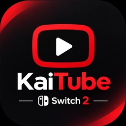

# KaiTube

<p align="center"></p>

Experimental native YouTube client for **Nintendo Switch 2**, by **Sank-kab**. Based on [switch-newpipe](https://github.com/mirusu400/switch-newpipe) and its dependencies. Requires KaiHEN compatible with ounce-devkit **20261114**.

## Status

Beta **0.0.2**, built with public ounce-devkit **20261114**. Includes the Home refresh/category fix and the SD session-replacement fix. The developer reports successful console smoke testing of the versioned 0.0.2 build. Host checks passed on GitHub Actions. The exact binary hash and static inspection findings are documented in [BINARY-AUDIT.md](BINARY-AUDIT.md).

## Features

- Public search and browsing; personalized Home, subscriptions and read-only YouTube history using locally imported cookies.
- Local history, saved videos, recent searches and playback positions.
- Quality and playback-speed selection, subtitles when retrievable, automatic decoder selection and resume/start-over.
- Sidebar navigation and menus in English, Italian, French, German, Spanish, Portuguese and Korean.

Authenticated feeds load up to 96 items and at most seven continuation pages. Account playlists and synchronized search history are not implemented. YouTube changes may break extraction or account feeds. HD performance depends on codec, decoder support and network.

## Build

On Linux, install Docker and Python 3. Clone this repository, then download the pinned public SDK and build:

```bash
bash scripts/download-sdk.sh
bash build.sh
```

Output: `output/KaiTube-beta0.0.2.nro`. Build log: `output/logs/build-native.log`. The `--public` argument remains compatible and requires no Google OAuth client. The build checks the SDK hash, translations, Switch 2 linkage, icon, author and NACP version.

Copy the NRO to `/switch/` on your SD. Keep a working backup. Existing settings and session paths are preserved.

## Proxy

Open **Settings → HTTP proxy** and enter the IPv4 address or hostname and port of an HTTP proxy that the console can reach, for example `192.168.1.10:8080`. The setting applies to new catalog, thumbnail and playback requests. The proxy must accept HTTPS tunnels (CONNECT). Clear the address to restore the default connection.

For HTTP Basic authentication, open **Settings → Proxy login** after saving the address. Enter the username, then the password. Enter special characters as written. To remove the login, clear the username. Changing the proxy address also clears the saved login.

KaiTube stores these credentials unencrypted in `/switch/kaitube_native_settings.json` on the SD card. With an HTTP proxy, Basic credentials travel unencrypted between the console and proxy. Use a trusted network or VPN for that connection.

## Account setup

Follow the **[step-by-step Firefox cookie guide and troubleshooting](docs/COOKIES.md)**. It explains exporting without an extension, using a clean single-account session, the exact SD path, how to confirm import success, and how to diagnose save/session errors.

Cookies are credentials and are stored unencrypted on SD. Never share cookies, session JSON or their backup/temporary files. A Google OAuth client is not required.

## Player controls

| Input | Action |
|---|---|
| A | Pause/resume |
| B | Hide controls; exit player when controls are hidden |
| Y | Timeline |
| L / R | Seek −10 / +10 seconds |
| ZL / ZR | Seek −30 / +30 seconds in timeline preview |
| Stick or D-pad left/right | Move timeline preview |
| Plus | Exit confirmation |

Controls appear on pause, touch and controller interaction. B can cancel initial loading.

## Reporting issues

Include the app/SDK/KaiHEN versions, reproduction steps and a sanitized log from `/switch/KaiTube-Native/logs/`. Logs may contain video titles, searches and URLs. Do not include cookie files, session JSON or account credentials. See [SECURITY.md](SECURITY.md).

## License and attribution

See [LICENSE.MD](LICENSE.MD), [THIRD_PARTY.md](THIRD_PARTY.md) and dependency license files in vendor. Preserve their notices. Nintendo/Morisawa font files, demo Pokémon images and the external SDK archive are excluded from this repository. Nintendo system fonts are accessed through the console at runtime by Borealis. This is an unofficial project, unaffiliated with Nintendo or Google.
